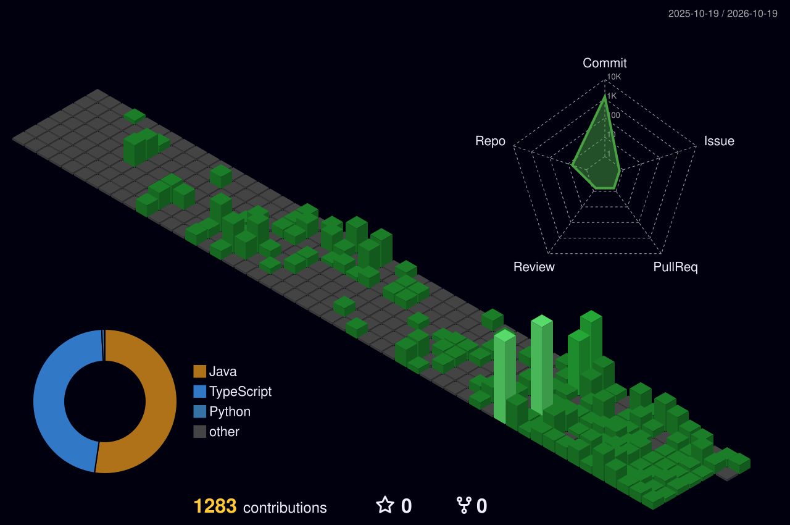

 <!-- Centered Intro with Particles GIF -->
<p align="center">
  
</p>

<h1 align="center">👋 Hey there, I'm <span style="color:#F57C00;">Yogananth J</span></h1>

<p align="center">
  <a href="https://iam-mjyogananth.pages.dev" target="_blank" rel="noopener noreferrer">
    
  </a>
</p>

---

## 🧭 About

```bash
$ whoami
> Yogananth J  # builder-at-heart

$ interests
> Software Development, AI/ML, Data Analytics
> LLMs, AI Agents, Generative AI, Prompt Engineering

$ currently_learning
> Exploring AI models, agent workflows, and prompt engineering
> Building practical projects and improving through experimentation

$ motto
> Make it work → Make it right → Make it fast
```

I'm a developer and aspiring AI engineer who enjoys exploring new technologies, building projects, and learning by experimenting. I'm currently focused on generative AI, AI agents, LLM applications, and prompt engineering.

## 🌐 Connect with Me

<p align="center">
  <a href="mailto:mjyogananth@gmail.com">
    
  </a>
  <a href="https://www.linkedin.com/in/yogananth-j-653400307/" target="_blank" rel="noopener noreferrer">
    
  </a>
  <a href="https://github.com/YogananthJ" target="_blank" rel="noopener noreferrer">
    
  </a>
</p>

---

## 🚀 Projects

### 🎓 Academic Projects

- **Full-Stack Event Management Platform** — A full-stack application project.
- **Wildfire Hotspot Detection** — An academic machine-learning project.
- **Global Supply Chain Analytics** — A data analytics project.

### 🧪 Personal Projects

- **Cognitive-Aware Conversational AI** — An AI conversational project.

  [Open Live Demo](https://cognitive-core-ai.streamlit.app/)

- **PDF RAG Intelligent Assistant** — Exploring document question answering with retrieval-augmented generation.

- **Resume Parser Automation Agent** — Exploring resume information extraction using CrewAI Studio and GPT-4o-mini.

- **CareerPilot AI** — A multi-channel AI career assistant designed to help students and fresh graduates with career guidance, skill-gap analysis, learning roadmaps, resume improvement, and interview preparation.

  [Open CareerPilot AI on Telegram](https://t.me/CareerPilotAgent2026_bot)

### 🏆 Hackathon Projects

- **Vibeathon 6.0 — Restaurant Nerve Center**

  Solo hackathon project; reached the **Top 60**. Built through iterative prompting and development using Lovable, ChatGPT, Claude, Playwright, and GitHub.

---

## 🛠️ Languages & Tools

### 💻 Programming Languages

<p>
  
  
  
  
  
</p>

### 🌐 Web Development

<p>
  
  
  
  
</p>

### 🗄️ Database

<p>
  
  
  
</p>

### 🤖 Machine Learning & Generative AI

<p>
  
  
  
  
  
  
  
  
</p>

### 🧠 AI Tools & Prompt Engineering

<p>
  
  
  
  
  
  
</p>

### 📊 Data Analytics

<p>
  
  
  
  
  
</p>

### 🎨 Frontend & UI Tools

<p>
  
</p>

### ⚙️ Development, Testing & Automation

<p>
  
  
  
  
  
  
  
  
</p>

---

## 📜 Certifications

- Claude 101 — Anthropic, Certificate of Completion.
- Claude Code 101 — Anthropic, Certificate of Completion.
- MongoDB Associate Developer (Node.js) — March 2025.

---

## 📈 GitHub Stats & Analytics

<p align="center">
  
</p>

<p align="center">
  
</p>

---

## 📊 My 3D Contribution Graph

<p align="center">
  
</p>

<p align="center">
  <a href="https://github.com/YogananthJ/YogananthJ/actions/workflows/profile-3d.yml">
    
  </a>
</p>

---

<p align="center">
  
</p>

<p align="center">
  <a href="https://iam-mjyogananth.pages.dev">Explore my portfolio →</a>
</p>
